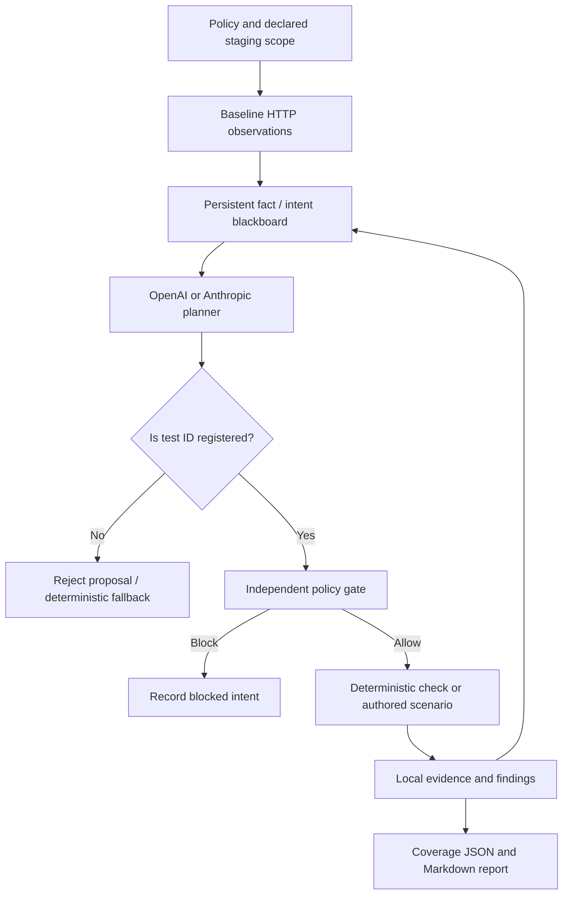

# ARTEMIS Architecture and design notes

## Adapted patterns

- **ARTEMIS blackboard, inspired by Cairn:** objective facts and intents are stored separately; planners choose from registered exploration intents based on current evidence. No source code from Cairn is copied.
- **ARTEMIS work/evidence lifecycle, informed by ARTEX:** a planner proposes work, a bounded executor runs it, event/evidence records are persisted, findings can be imported from scanner outputs, and a report summarizes the run. No source code from ARTEX is copied.
- **Policy-gated execution:** the model is never given a raw HTTP execution tool. It can only select a registered test ID; each request is constructed by local deterministic code and rechecked against scope and budget.
- **Local secret boundary:** credentials are attached by the local HTTP client. The planner receives redacted observations; raw evidence stays in the run directory.

## Current limitations by design

- Single planner/worker loop, not a distributed multi-agent runtime.
- No automatic Burp extension or MCP server integration in this archive.
- Scenario workflows are declarative and author-controlled. Stateful payment scenarios need app-specific setup, expected outcomes, and cleanup.
- Source-level weakness coverage requires external SAST/SCA/fuzzing tools; their SARIF results can be imported but a single result is not treated as proof of full coverage.
- No generic SSRF blind-callback, destructive upload, brute-force, denial-of-service, or arbitrary exploit-payload tests are executed.

## Runtime sequence

